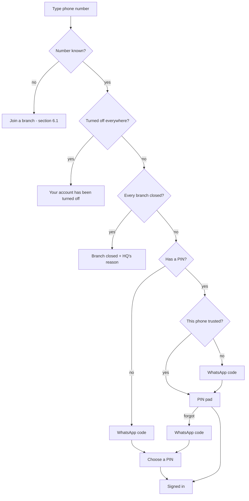

# Authentication — every process, case and scenario

How people get into MANA Wash Manager (the team app) and the MANA Car Wash app (the customer
app), how they stay in, and how they are taken out. Plain English first, the technical detail
underneath each part. Everything here matches the code as of this document; the code references
at the end say where each rule lives.

---

## 1. The short version

- **Your phone number is who you are.** There are no usernames, emails or passwords.
- **Day to day you type a PIN** on a phone you have used before. Owners, managers and HQ use a
  6-digit PIN; staff use 4 to 6 digits.
- **A phone you haven't used before needs a WhatsApp code first.** After that the phone is
  "trusted" and the PIN is enough, until you sign out on it or your PIN is reset.
- **Forgot your PIN?** Get a WhatsApp code and choose a new PIN. No one else is needed.
- **Lost your phone?** Someone above you resets your PIN: the owner (or a manager, for staff),
  Mana Wash HQ for owners, Sprixia for HQ. A reset never signs anyone in. You get back in with a
  WhatsApp code on your new phone and are told who reset you.
- **Nobody can start a car wash from the app.** Mana Wash HQ opens every branch and names its
  owner. Everyone else joins a branch by asking (the owner or a manager approves) or by being
  added from the Team screen.
- **HQ can pause or close a branch.** Paused: the team can finish open washes but not start new
  ones. Closed: nobody there can sign in.
- **Customers** sign in to the MANA Car Wash app with a WhatsApp code every time; they have no PIN.

---

## 2. Who is who

| Who | What they are | Who manages them |
| --- | --- | --- |
| **Staff** | Washers and counter staff. Record washes, take payments. | Owner, manager or HQ |
| **Manager** | Everything staff do, plus: add staff, approve or decline join requests, reset staff PINs. **No money fixes**, prices, reports or settings. | Owner or HQ |
| **Owner** | Runs the branch: team, money fixes, prices, reports, settings. | HQ only |
| **Mana Wash HQ** | A badge, not a role. A phone number listed as an HQ admin of the business. Sees all branches, opens, pauses, closes and reopens branches, adds and removes owners, resets owners' PINs. | Other HQ admins; Sprixia resets HQ PINs |
| **Sprixia** | The software company. Not a user of the app. Resets HQ PINs from a support script after a phone call. | — |
| **Customer** | Uses the MANA Car Wash app. Separate sign-in, no PIN. | Themselves |

Rules that follow from this:

- One phone number can work at **up to 10 branches**, with a different role at each (for example
  owner at one, staff at another). It is always **one person with one PIN** across all of them.
- HQ is usually also an owner of a branch, but the HQ badge comes from the number being an HQ
  admin, not from any branch role.
- Nobody can change **their own** role or access, remove themselves, or reset their own PIN from
  the Team screen (they change their own PIN from More → Change PIN instead).
- A branch always keeps **at least one active owner**. Nobody (not even HQ) can remove, turn off
  or demote the last one.

Technical: roles are `owner | manager | staff` on the `users` row (one row per person per branch).
HQ is a row in `business_admins (business_id, phone)`. The rule for who manages whom is
`canManageMember(actor, target, hq)` in `packages/domain/src/team.ts`.

---

## 3. The building blocks

### 3.1 Phone number

10-digit Indian mobile number. It is the identity: unique across every branch (the same number
is the same person everywhere). Changing it is a separate, guarded process (section 7.4).

### 3.2 PIN

| | Owners, managers, HQ ("seniors") | Staff |
| --- | --- | --- |
| Length | exactly 6 digits | 4 to 6 digits |
| Weak PINs refused | yes | yes |

- **Weak PINs** are refused: all the same digit (`1111`, `000000`) and straight runs up or down,
  including ones that wrap past 9 (`1234`, `987654`, `7890`).
- **One PIN per person**, shared by every branch they work at. Setting, changing or clearing it
  changes it everywhere at once.
- **5 wrong tries lock PIN sign-in for 15 minutes.** The count and the lock are per person, not
  per branch or phone, so trying another branch never buys extra guesses. The same counter
  covers the "current PIN" asked for when changing the PIN or the phone number.
- Stored only as a salted hash (PBKDF2-SHA256, 100,000 rounds). Nobody, including Sprixia, can
  see a PIN.

### 3.3 WhatsApp code

A 6-digit code sent on WhatsApp. Used for: a new phone, a first sign-in, a forgotten or reset PIN,
joining a branch, changing your number, and every customer sign-in.

| Limit | Value |
| --- | --- |
| Code is valid for | 10 minutes |
| Wrong tries per code | 5, then ask for a new code |
| Wait before asking again | 30 seconds |
| Codes per number per hour | 5 |
| Codes per internet connection per hour, for numbers without an account (join requests, customers) | 20 |

Asking for a new code cancels the old one. Codes are stored only as a hash.

### 3.4 Trusted phone

Each install of the team app makes a long random key and keeps it in the phone's secure storage
(Keychain / Keystore). The server stores only a hash of it next to the person's number.

- A phone becomes **trusted** for a number when that number's WhatsApp code is entered on it, or
  when a new teammate finishes joining on it.
- A trusted phone goes **straight to the PIN pad**. An untrusted phone must enter a WhatsApp
  code first; the server refuses a PIN from an untrusted phone **before** checking it, so a
  stranger's phone can't even spend PIN guesses.
- Trust ends when the person **signs out on that phone**, when someone **resets their PIN**
  (every phone is forgotten), or when they **move to a new number** (phones trusted for the old
  number are forgotten; the phone that made the move is trusted for the new one).
- Uninstalling the app throws the key away, so a reinstall is a new phone.

Technical: header `x-device-key` (32–128 chars), stored as SHA-256 in `trusted_devices (phone,
device_hash)`. App side: `apps/manager/src/api/device.ts`.

### 3.5 Session

After a successful sign-in the phone holds a session (a signed token) for **30 days**. On every
request the server re-reads the person and their branch from the database, so these take effect
without waiting for the token to run out:

| Change | What the phone sees |
| --- | --- |
| Turned off by owner / manager / HQ | Signed out: "Your account has been turned off. Ask the owner if this is a mistake." |
| Removed from the team | Signed out |
| PIN changed, reset, or self-reset; number changed | Signed out: "Your PIN or phone number was changed. Sign in again." (the phone that made the change gets a fresh session and stays in) |
| Branch closed by HQ | Signed out with HQ's reason |
| Branch paused by HQ | Stays in; a banner shows HQ's reason; new washes are blocked |
| Role changed | Applies on the next request (screens update when the app refreshes) |
| Owner or manager still on a short PIN | Must choose a 6-digit PIN before anything else |
| 30 days pass | Signed out: "Your session ended. Please sign in again." |

**Timing.** Every change (saving a wash, taking cash, editing anything) is checked fresh, so it
is blocked immediately. Screens that only *show* data may reuse the check for up to 30 seconds
on the same server, so a person who was just turned off, or a branch that was just closed, can
still *see* (never change) for up to 30 seconds.

Technical: JWT claims `sub` (user row), `shopId`, `role`, `phone`, `sv` (session version). Any
PIN set/clear, reset, removal, turning off or number change bumps `users.session_version`, which
revokes older tokens (`session_revoked`).

---

## 4. Signing in — how the app decides what to ask

The person types their number. The server answers with the next step:



Which branch opens: the one this phone last used, if the person still works there and it isn't
closed; otherwise their first open branch. They can switch afterwards (section 7.5).

Technical: `POST /auth/start` → `{ next: 'new' | 'code' | 'pin' | 'verify_device' }`, or 403
`account_disabled` / `branch_closed`. Then `POST /auth/pin/login`, or `POST /auth/code/request`
followed by `POST /auth/code/verify` with `purpose: 'device'` (new phone, PIN next) or
`purpose: 'reset'` (no PIN or forgot PIN: clears it and signs in to choose a new one).

---

## 5. Sign-in scenarios

Each scenario: the situation, what the person does, and what happens.

### 5.1 Everyday sign-in (trusted phone)
Number → PIN → in. Nothing else.

### 5.2 Wrong PIN
"That PIN isn't right. N tries left." After the 5th wrong try: "Too many wrong PINs. Try again
later." for 15 minutes. They can wait, or use **Forgot PIN?** (5.5) right away, which also clears
the lock.

### 5.3 New phone, PIN remembered
Number → "Confirm with a code on WhatsApp" → code → PIN → in. The new phone is now trusted. Old
phones stay trusted until signed out there.

### 5.4 First ever sign-in (no PIN yet)
Applies to a new owner HQ just named, someone the owner/manager added from Team, or someone whose
PIN was reset. Number → WhatsApp code → choose a PIN (6 digits for owners/managers/HQ, 4–6 for
staff) → in. The phone is trusted.

### 5.5 Forgot PIN, phone in hand
**Forgot PIN? → Send code on WhatsApp** → code → choose a new PIN → in. Works on any phone.
- The old PIN is cleared on every branch, every other phone is signed out (but stays trusted, so
  the new PIN is enough there).
- If they close the app before choosing the new PIN, they simply have no PIN: next time it's
  5.4.

### 5.6 Lost phone / no access to the old WhatsApp
They can't get a code on the old number, so someone above them resets their PIN (section 8).
Then: new phone, same number (a new SIM for the same number) → WhatsApp code → choose a PIN →
in, with a notice: "Your PIN was reset by *Name (Owner)* on *date*."
If they have a **new number** too, the owner (or HQ, for an owner) removes the old number and
adds the new one from Team.

### 5.7 PIN locked and urgent
Same as 5.5: a WhatsApp code clears both the PIN and the lock.

### 5.8 Turned off
At sign-in: "Your account has been turned off." If they're turned off at one branch but active at
another, they can still sign in to the other one.

### 5.9 Branch closed
At sign-in: the closed message with HQ's reason, if every branch they work at is closed. If they
work at another open branch they're signed in there instead, and the closed one disappears from
their branch list.

### 5.10 Branch paused
Sign-in works normally. Home shows "Paused by Mana Wash HQ: *reason*". See 9.4 for what still
works.

### 5.11 Owner or manager with an old 4- or 5-digit PIN
They sign in with the old PIN, then the app shows **Choose a 6-digit PIN**: enter the current PIN,
then a new 6-digit one. Until then nothing else in the app works (the server refuses everything
except the sign-in pages). The same happens when a staff member with a 4-digit PIN is promoted
to manager or owner.

### 5.12 Number not registered
"New number" → they can ask to join a branch with its 6-digit Branch ID (6.1). There is no way to
start a new car wash from the app.

### 5.13 WhatsApp code problems
| What they see | Why | What to do |
| --- | --- | --- |
| Wait N seconds | Asked again within 30 s | Wait |
| Too many codes asked for. Try again in N min. | 5 codes in the last hour | Wait, or call the owner |
| That code isn't right. N tries left. | Typo | Retype |
| This code has expired or was replaced. | Older than 10 min, 5 wrong tries, or a newer code was sent | Tap Send a new code |
| WhatsApp codes aren't set up on the server yet. | Server configuration | Sprixia support |
| Couldn't send the WhatsApp message. | WhatsApp provider failed | Try again in a minute |

### 5.14 Someone tries to get into another person's account
- With only the number: they need the WhatsApp code, which goes to the owner's WhatsApp.
- With the number on their own phone and a guessed PIN: refused before the PIN is checked
  (untrusted phone).
- With the person's unlocked, signed-in phone: they can use the app as that person, but cannot
  change the PIN or the number without the current PIN.
- An owner, manager or HQ can't sign in as anyone. They can only clear a PIN, and the person is
  told who did it.

### 5.15 Too many attempts from one place
Requests are also capped per internet connection per 10 minutes (section 12). Beyond that the app
shows "Too many tries from this network. Wait N min and try again."

---

## 6. Getting onto a team

### 6.1 Asking to join a branch (new number)
1. Number → "New number" → **Join a branch** → type the Branch ID → the app shows "Join *MANA Car
   Wash, Hyderabad*?" so a typo is caught.
2. WhatsApp code to prove the number.
3. Their name → request sent. The phone shows "Waiting for approval".
4. The owner or a manager sees it in **More → Team** and approves or declines.
5. On approval the phone asks them to choose a PIN (4–6 digits) and signs them in. That phone is
   trusted.

Rules:
- They join as **staff**. The owner can make them a manager afterwards.
- One open request per number. Asking again (same or another branch) replaces the old request.
- A request expires after **7 days**. They can cancel it from the waiting screen.
- A branch holds at most **10 waiting requests**; beyond that: "This shop has too many requests
  waiting."
- **Paused** branch: "This branch isn't taking new teammates right now." **Closed** branch: not
  found.
- A number that already has an account can't ask to join; the other branch's owner adds it from
  Team instead (6.2).

| What happens to the request | Phone shows |
| --- | --- |
| Approved | Choose a PIN → in |
| Declined | "Not approved" |
| Cancelled by them | Back to start |
| 7 days pass | "Expired" |
| Owner added them from Team meanwhile | Request cancelled; they sign in normally (5.4) |

### 6.2 Added from Team
The owner (any role) or a manager (staff only) adds a name and number in **More → Team**.
- New number: they sign in with a WhatsApp code and choose a PIN (5.4).
- Number already working at another branch: they **keep their PIN and name**; the new branch
  simply appears in their branch list. On a phone already trusted they go straight to the PIN.
- Refused if the number is already on this team, or already works at 10 branches.

### 6.3 HQ opens a branch
HQ: **More → Mana Wash HQ → All branches → Open a branch** with the owner's name and number.
- New owner number: they sign in with a WhatsApp code and choose a 6-digit PIN.
- An existing person (owner elsewhere, or staff somewhere): they keep their PIN; if it's shorter
  than 6 digits they're asked for a 6-digit one at next sign-in (5.11).
- Any open join request from that number is cancelled.

### 6.4 HQ adds or replaces an owner
HQ adds a second owner, promotes a teammate to owner, or removes an owner. Owners and managers
can't (the Team screen says "Only Mana Wash HQ can add, change or remove branch owners").

### 6.5 Becoming HQ
An existing HQ admin adds a number to the business's HQ admins. The first HQ admin is set up by
Sprixia. HQ gets the **Mana Wash HQ** section in More on whichever branch they're signed in to.

---

## 7. While signed in

### 7.1 Change PIN (More → Change PIN)
Enter the current PIN, then the new one (6 digits for seniors). Changes it on every branch.
Every other phone is signed out (and stays trusted).

### 7.2 Move to a 6-digit PIN
Same as 7.1, triggered automatically (5.11).

### 7.3 Change name
More → Edit profile. Changes it on every branch.

### 7.4 Change phone number (More → Edit profile → number)
1. Type the new number → a WhatsApp code goes to the **new** number (so a typo can't lock them
   out).
2. Enter that code **and their current PIN** (so a borrowed, unlocked phone can't steal the
   account).
3. The number changes on every branch. This phone stays signed in and becomes trusted for the
   new number; every other phone is signed out and phones trusted for the old number are
   forgotten.

Refused if: it's the same number, they have no PIN yet, the new number belongs to someone else,
or the PIN is wrong/locked.

### 7.5 Switch branch
Tap the branch name at the top → pick another branch. No PIN again (same person, already proved).
Closed branches aren't listed; paused ones are marked "Paused". Refused if turned off at that
branch.

### 7.6 Sign out (More → Sign out)
Ends the session on this phone and **stops trusting this phone** for the number. Next time on
this phone: WhatsApp code, then PIN. Works even if the session had already been ended remotely.

### 7.7 Signed out by someone else
See the table in 3.5. The app returns to the sign-in screen and shows why.

---

## 8. PIN resets — the ladder

| Whose PIN | Who can reset it | Where |
| --- | --- | --- |
| Staff | Owner, manager, HQ | More → Team → the person → Reset PIN |
| Manager | Owner, HQ | More → Team → the person → Reset PIN |
| Owner | HQ | More → Mana Wash HQ → All branches → the branch → Reset PIN |
| Anyone who works at more than one branch | HQ only (their one PIN covers branches the resetter doesn't run) | More → Mana Wash HQ → All branches → the branch → Managers and staff → Reset PIN |
| HQ | Sprixia, after a phone call | support script (section 14) |
| Yourself | Nobody resets themselves; use Forgot PIN? (5.5) or Change PIN (7.1) | — |

What a reset does:
1. Clears the PIN on **every** branch the person works at.
2. Signs them out on **every** phone.
3. **Forgets every phone** they trusted.
4. Records who did it (name and role, e.g. "Ravi (Owner)", "Sreenivasulu (Mana Wash HQ)") in the
   reset log.
5. Does **not** sign anyone in. The person proves their number with a WhatsApp code, chooses a
   new PIN, and sees: "Your PIN was reset by *Name (Role)* on *date*."

The app asks for confirmation before resetting.

---

## 9. Taking access away

### 9.1 Turn off (Team → the person → access off)
Signed out immediately. Can't sign in to that branch. Their work and name stay in the records.
Turning back on lets them sign in again with their existing PIN.

### 9.2 Remove from team
Off the team for good at this branch. Signed out. Their number can join another branch later.
Their other branches are not affected.

### 9.3 Change role
Owner: staff ↔ manager. HQ: anything, including owner. Applies on the next request. Promoted to
manager/owner with a short PIN → asked for a 6-digit PIN (5.11).

### 9.4 Pause a branch (HQ, with a reason of 3–200 characters)
- Everyone stays signed in and sees HQ's reason on Home.
- **Still works:** viewing everything; finishing washes already open (status, washers, sellers,
  payment, payment method, void); photos; the cash counter's float, close and reopen; sign-in
  and account pages; HQ's own work.
- **Blocked:** new washes and every other change. The app shows "Paused by Mana Wash HQ".
- No new join requests.

### 9.5 Close a branch (HQ, with a reason)
- Everyone there is signed out with HQ's reason and can't sign in to it.
- People who also work at another branch are signed in there instead.
- Hidden from customers and from join requests.
- HQ can't close the branch it is currently signed in to (switch first).

### 9.6 Reopen
HQ sets the branch back to Active. Everyone can sign in again with their existing PIN. Every
status change is logged with who made it and why (All branches → the branch → history).

---

## 10. Who can do what (team and access)

| Action | Staff | Manager | Owner | HQ |
| --- | :-: | :-: | :-: | :-: |
| Change own PIN / name / number | ✓ | ✓ | ✓ | ✓ |
| See join requests, approve, decline | | ✓ | ✓ | ✓ |
| Add, edit, turn off, remove **staff** | | ✓ | ✓ | ✓ |
| Reset a **staff** PIN | | ✓ | ✓ | ✓ |
| Add, edit, turn off, remove **managers**; reset their PIN | | | ✓ | ✓ |
| Add, edit, remove **owners**; reset their PIN | | | | ✓ |
| Reset anyone who works at 2+ branches | | | | ✓ |
| Open, pause, close, reopen branches | | | | ✓ |
| See all branches' numbers | | | | ✓ |

The HQ column applies on top of whatever role HQ has at the branch they're signed in to (Team
actions on a branch need the owner or manager role there; HQ's All branches screen covers every
branch).

---

## 11. The customer app (MANA Car Wash)

- **Sign-in:** phone number → WhatsApp code → in. No PIN, no trusted phones.
- **Only registered customers sign in.** If the number is a customer at one or more branches,
  they see their cars, washes, photos, rewards and receipts from those branches only.
- **Unknown number:** they can't see anything, but get a service-request pass (valid 30 days) to
  ask for a wash and follow that request.
- **Session:** 90 days. Re-checked on every request.
- **Sign out everywhere** (in the app) ends every customer session for that number.
- **Delete account** removes their app account and signs them out everywhere.
- Same code limits as section 3.3; 30 sign-in requests per connection per 10 minutes.

Technical: `POST /c/auth/code`, `POST /c/auth/verify` → `{ status: 'signed_in', token }` or
`{ status: 'request', ticket }`. `requireCustomer` re-reads the account (session version) each
time. Customer tokens and team tokens are separate and not interchangeable.

---

## 12. All limits in one place

| Limit | Value |
| --- | --- |
| Session (team app) | 30 days |
| Session (customer app) | 90 days |
| PIN length | seniors 6; staff 4–6 |
| Wrong PINs before lock | 5 |
| Lock time | 15 minutes |
| WhatsApp code | 6 digits, 10 min, 5 tries |
| Code resend wait | 30 seconds |
| Codes per number per hour | 5 |
| Codes per connection per hour (join / customer) | 20 |
| Join verification pass | 30 minutes |
| Join request | 7 days; 10 waiting per branch; 1 open per number |
| Branches per number | 10 |
| Pause/close reason | 3–200 characters |
| Requests per connection per 10 min | number check 60; PIN sign-in 40; WhatsApp codes 20; change number 10; number-change code 10; join flow 60; customer sign-in 30 |
| "View only" delay after removal/closure | up to 30 seconds |

---

## 13. Error codes

What the server returns and what the team app does with it.

| Code | HTTP | Meaning | App behaviour |
| --- | --- | --- | --- |
| `unauthorized` | 401 | No/invalid token, removed, or wrong branch | Back to sign-in |
| `session_revoked` | 401 | PIN or number changed/reset since sign-in | Back to sign-in with notice |
| `account_disabled` | 403 | Turned off | Back to sign-in with notice |
| `branch_closed` | 403 | HQ closed the branch | Back to sign-in with HQ's reason |
| `branch_paused` | 403 | Change not allowed while paused | Toast / banner with HQ's reason |
| `pin_upgrade_required` | 403 | Senior with a short PIN | Choose a 6-digit PIN screen |
| `device_not_trusted` | 403 | PIN from an untrusted phone | Switches to the WhatsApp code step |
| `device_key_required` | 400 | Old app without a phone key | "Update the app" |
| `pin_not_set` | 409 | No PIN yet | Switches to the WhatsApp code step |
| `invalid_pin` | 401 | Wrong PIN (with tries left) | Shows tries left |
| `pin_locked` | 423 | Too many wrong PINs | Shows the lock; offers Forgot PIN |
| `current_pin_required` | 400 | Changing PIN without the current one | Asks for it |
| `weak_pin` | 400 | Too short/long, repeated or sequence | Shows why |
| `invalid_code` | 401 | Wrong WhatsApp code | Shows tries left |
| `code_expired` | 410 | Code too old, used up or replaced | Send a new code |
| `too_soon` | 429 | Code asked again within 30 s | Countdown |
| `too_many` | 429 | Hourly code cap | Shows the wait |
| `rate_limited` | 429 | Too many requests from one connection (section 12) | "Too many tries from this network. Wait N min" |
| `code_not_configured` | 503 | WhatsApp not set up on the server | Call support |
| `send_failed` | 502 | WhatsApp send failed | Try again |
| `no_account` | 404 | Number unknown | Join flow |
| `already_registered` | 409 | Join flow for a number that has an account | Sign in instead |
| `shop_busy` | 429 | 10 join requests waiting | Ask the owner |
| `not_approved` | 409 | Choosing a PIN before approval | Keep waiting |
| `pin_already_set` | 409 | Finishing a join twice | Sign in instead |
| `same_phone` / `phone_taken` | 400 / 409 | Number change problems | Shows why |
| `forbidden` / `hq_only` | 403 | Team action above your role | Shows who can |
| `works_elsewhere` | 403 | Reset of a multi-branch person by a non-HQ | "Only Mana Wash HQ can reset their PIN" |
| `cannot_change_self` | 400 | Own role/access/removal/reset | Shows where to do it instead |
| `last_owner` | 400 | Would leave the branch with no owner | Shows why |
| `too_many_shops` | 409 | Number already at 10 branches | Shows why |
| `cannot_close_own` | 400 | HQ closing the branch they're in | Switch first |

---

## 14. Support runbooks

**Staff or manager forgot their PIN** — tell them: Forgot PIN? → WhatsApp code. If they no
longer have that WhatsApp: the owner taps Reset PIN in Team.

**Owner lost their phone** — HQ: All branches → the branch → Reset PIN. The owner then signs in
on the new phone with a WhatsApp code (same number, new SIM).

**HQ lost their phone / PIN and has no WhatsApp** — Sprixia, after confirming the person on a call:

```bash
cd apps/api
npm run support:reset-pin -- --phone 98XXXXXXXX --into remote --yes --by "Name (Sprixia)"
```

`--into local` or `--into staging` to rehearse first; `--by` is what the person is shown.

**Someone left the business** — the owner (or a manager, for staff) removes them from Team. For
an owner, HQ does it. If they had the phone shared with someone else, nothing more is needed:
removal signs them out.

**Phone stolen** — reset the person's PIN (forgets every phone). If they still have the
number's WhatsApp they can instead do Forgot PIN? on a new phone, but a reset is safer because it
also forgets the stolen phone.

**"The code never arrives"** — check the number is on WhatsApp; wait 30 s and resend; after 5
codes in an hour they must wait. Server side: WhatsApp credentials (`code_not_configured` /
`send_failed`).

**"It says this branch is closed"** — HQ closed it; HQ reopens it in All branches.

**Branch must stop taking new washes today** — HQ pauses it with a reason.

---

## 15. Security design notes

- **Something you have + something you know.** Day-to-day sign-in needs a trusted phone *and*
  the PIN. A new phone needs the number's WhatsApp *and* the PIN.
- **The PIN is never checked from an untrusted phone**, so a stranger can't guess PINs at all.
- **Guessing is bounded** per person (5 PIN tries / 15 min, 5 tries per code, 5 codes per hour)
  and per connection (section 12). Parallel guesses can't exceed the allowance: a guess is
  reserved before it is checked.
- **Nobody signs in as someone else.** Resets only clear a PIN; the person must prove the number
  and is told who reset them; every reset is logged.
- **Sensitive changes need the current PIN** (change PIN, change number), so a borrowed unlocked
  phone can't take over the account.
- **Every request re-checks** the person, their access, their PIN version and the branch status
  against the database.
- **Stored secrets are hashed**: PINs (PBKDF2), codes and phone keys (SHA-256). Tokens are signed
  with the server's secret.
- **Branches are isolated**: a session is locked to one branch's data; another branch needs a
  switch, which only works for the same person.
- **Customer and team sign-ins are separate** systems with separate tokens.

---

## 16. Development and testing

- Local and staging accept the code **`000000`** instead of sending WhatsApp (dev mode /
  `WHATSAPP_OTP_BYPASS`). Production never does.
- Plain local database (`npm run db:reset:local`): owner and HQ `9100000000`, no PIN yet (sign
  in with the code, then choose one).
- Demo data (`npm run db:seed:demo`, on top of a reset): owner and HQ Hrushikesh `9888626111`,
  PIN `258025` for everyone.
- Checks (from `apps/api`, against a running local API on a freshly reset database — not on top
  of demo data):
  - `npm run test:access` — roles, resets, trusted phones, the 6-digit upgrade, pause/close,
    HQ overview.
  - `npm run test:signup` — HQ opening branches and owners, join requests.
  - `npm run test:races` — parallel PIN/code guesses, double approvals, number change.
  - `npm run test:isolation` — branches can't see each other.
  - `npm run test:customer-app` — customer sign-in.
- Unit tests for PIN rules and roles: `packages/domain`.

---

## 17. Known limits

- **WhatsApp is the only way onto a new phone.** No SMS fallback yet.
- **Whoever controls a number's WhatsApp can self-reset its PIN** (5.5). The PIN protects
  against someone with only the phone *or* only the number, not both.
- **Up to 30 seconds of "view only"** after someone is removed/turned off or a branch is closed
  (3.5). Changes are blocked immediately.
- **Older app versions can't sign in** with the new rules (they don't send a phone key). Everyone
  must update the app when this is released. Already signed-in old apps keep working until their
  session ends, except owners/managers on short PINs, who need the update to choose a 6-digit PIN.
- **HQ whose role at their branch is staff** isn't forced onto a 6-digit PIN until they next
  change it (HQ numbers are normally owners).
- **The HQ web dashboard and Sprixia admin panel** don't exist yet; HQ works from the app, Sprixia
  from the support script.

---

## 18. Where it lives in the code

| Area | File |
| --- | --- |
| Sign-in, PIN, codes, sign out, change PIN/name/number, switch branch | `apps/api/src/routes/auth.ts` |
| Join a branch | `apps/api/src/routes/signup.ts` |
| Team: add, edit, remove, approve, reset | `apps/api/src/routes/team.ts` |
| HQ: branches, owners, status, overview, reset owners | `apps/api/src/routes/business.ts` |
| Session checks, pause rules, 30 s view cache | `apps/api/src/middleware/auth.ts` |
| Reset (clear PIN, sign out, forget phones, log) | `apps/api/src/lib/pinReset.ts` |
| Phone key | `apps/api/src/lib/device.ts`, `apps/manager/src/api/device.ts` |
| PIN hashing | `apps/api/src/lib/pin.ts` |
| WhatsApp codes | `apps/api/src/lib/phoneCode.ts`, `apps/api/src/lib/loginCode.ts` |
| Rules and limits (roles, PIN rules, constants) | `packages/domain/src/team.ts` |
| Trusted phones and reset log | `packages/db/src/repositories/securityRepo.ts` |
| Rate limits | `apps/api/src/index.ts` |
| Customer sign-in | `apps/api/src/routes/customerApp.ts`, `apps/api/src/middleware/customer.ts` |
| HQ support reset | `apps/api/scripts/reset-pin.mjs` |
| App: sign-in screens | `apps/manager/src/screens/LoginScreen.tsx`, `CreatePinScreen.tsx` |
| App: session, sign out, notices | `apps/manager/src/api/auth.tsx`, `client.ts`, `network.ts` |
