# Authentication: every person, every scenario

How people get into **Mana Wash Partner** (the team app) and the **Mana Wash** app (the customer
app), how they stay in, and how they are taken out.

Every part has three layers:

1. **Plain English** for owners, managers and support.
2. **A flowchart** of exactly what happens.
3. **Technical notes** with the API routes and error codes, for developers.

Everything here matches the code. Section 20 says where each rule lives.

> The diagrams are written in Mermaid. GitHub, VS Code (with a Mermaid preview) and most
> Markdown viewers draw them as charts.

---

## Contents

1. [The short version](#1-the-short-version)
2. [Who is who](#2-who-is-who)
3. [The building blocks](#3-the-building-blocks)
4. [Signing in: how the app decides what to ask](#4-signing-in-how-the-app-decides-what-to-ask)
5. [Sign-in scenarios](#5-sign-in-scenarios)
6. [Getting onto a team](#6-getting-onto-a-team)
7. [While signed in](#7-while-signed-in)
8. [PIN resets: the ladder](#8-pin-resets-the-ladder)
9. [Taking access away](#9-taking-access-away)
10. [Journeys by person](#10-journeys-by-person)
11. [Who can do what](#11-who-can-do-what)
12. [The customer app](#12-the-customer-app-mana-wash)
13. [All limits in one place](#13-all-limits-in-one-place)
14. [Error codes](#14-error-codes)
15. [Support runbooks](#15-support-runbooks)
16. [Security design](#16-security-design)
17. [Development and testing](#17-development-and-testing)
18. [Known limits](#18-known-limits)
19. [Glossary](#19-glossary)
20. [Where it lives in the code](#20-where-it-lives-in-the-code)

---

## 1. The short version

- **Your phone number is who you are.** There are no usernames, emails or passwords.
- **Day to day you type a PIN** on a phone you've used before. Owners, managers and HQ use a
  6-digit PIN; staff use 4 to 6 digits.
- **A new phone needs a WhatsApp code first.** After that the phone is "trusted" and the PIN is
  enough, until you sign out on it, remove it, or your PIN is reset.
- **Forgot your PIN?** Get a WhatsApp code and choose a new one. Staff can do this on any phone.
  Owners, managers and HQ can only do it on a phone where they've used their PIN before.
- **Lost your phone?** The person above you resets your PIN: the owner (or a manager, for staff),
  Mana Wash HQ for owners, Sprixia for HQ. A reset never signs anyone in. You get back in with a
  WhatsApp code and are told who reset you.
- **Nobody signs themselves up.** Mana Wash HQ opens every branch and names its owner. The owner
  (or a manager, for staff) adds everyone else from Team.
- **HQ can pause or close a branch.** Paused: open washes can be finished, nothing new started.
  Closed: nobody there can sign in.
- **Customers** sign in to the Mana Wash app with a WhatsApp code each time. They have no PIN.

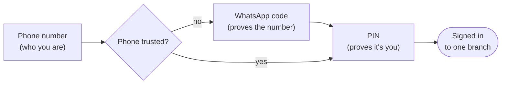

---

## 2. Who is who

| Who | What they are | Who manages them |
| --- | --- | --- |
| **Staff** | Washers and counter staff. Record washes, take payments. | Owner, manager or HQ |
| **Manager** | Everything staff do, plus: add staff and reset staff PINs. **No money fixes**, prices, reports or settings. | Owner or HQ |
| **Owner** | Runs the branch (own or franchise): team, money fixes, prices, reports, settings. | HQ only |
| **Mana Wash HQ** | A badge, not a role: a phone number listed as an HQ admin of the business. Opens, pauses, closes and reopens branches; adds and removes owners; resets owners' PINs; changes services and prices for every branch. | Other HQ admins; Sprixia resets HQ PINs |
| **Sprixia** | The technology partner. Not a user of the app. Resets an HQ PIN from a support script after a phone call. | — |
| **Customer** | Uses the Mana Wash app. Separate sign-in, no PIN. | Themselves |

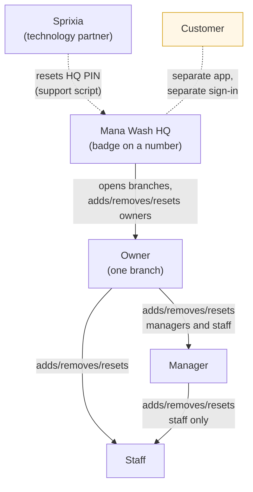

Rules that follow from this:

- One phone number can work at **up to 10 branches**, with a different role at each (owner at
  one, staff at another). It is always **one person with one PIN** across all of them.
- The HQ badge comes from the number being an HQ admin, not from a branch role. HQ is usually
  also the owner of a branch.
- Nobody can change **their own** role or access, remove themselves, or reset their own PIN from
  Team. They change their own PIN from More → Change PIN.
- A branch always keeps **at least one active owner**. Nobody, not even HQ, can remove, turn off
  or demote the last one.
- The business always keeps **at least one HQ admin**.

Technical: roles are `owner | manager | staff` on the `users` row (one row per person per
branch). HQ is a row in `business_admins (business_id, phone)`. Who manages whom:
`canManageMember(actor, target, hq)` in `packages/domain/src/team.ts`.

---

## 3. The building blocks

### 3.1 Phone number

A 10-digit Indian mobile number (starts with 6–9). It is the identity: the same number is the
same person at every branch. Changing it is a separate, guarded process (7.4).

### 3.2 PIN

| | Owners, managers, HQ ("seniors") | Staff |
| --- | --- | --- |
| Length | exactly 6 digits | 4 to 6 digits |
| Weak PINs refused | yes | yes |
| Self-reset with a WhatsApp code | only on a phone where they've used their PIN | on any phone |

- **Weak PINs refused:** all one digit (`1111`, `000000`) and straight runs up or down, including
  ones that wrap past 9 (`1234`, `987654`, `7890`).
- **One PIN per person**, shared by every branch they work at. Setting, changing or clearing it
  changes it everywhere at once.
- **Wrong PINs:** 5 wrong tries lock PIN sign-in. Each lock in a row lasts longer: **15 minutes,
  then 1 hour, then 1 day** each time. A right PIN or a new PIN starts the count again.
- The count is per person, not per branch or phone, so trying another branch never buys extra
  guesses. The same count covers the "current PIN" asked for when changing the PIN or number.
- Stored only as a salted hash (PBKDF2-SHA256, 100,000 rounds). Nobody, including Sprixia, can
  see a PIN.

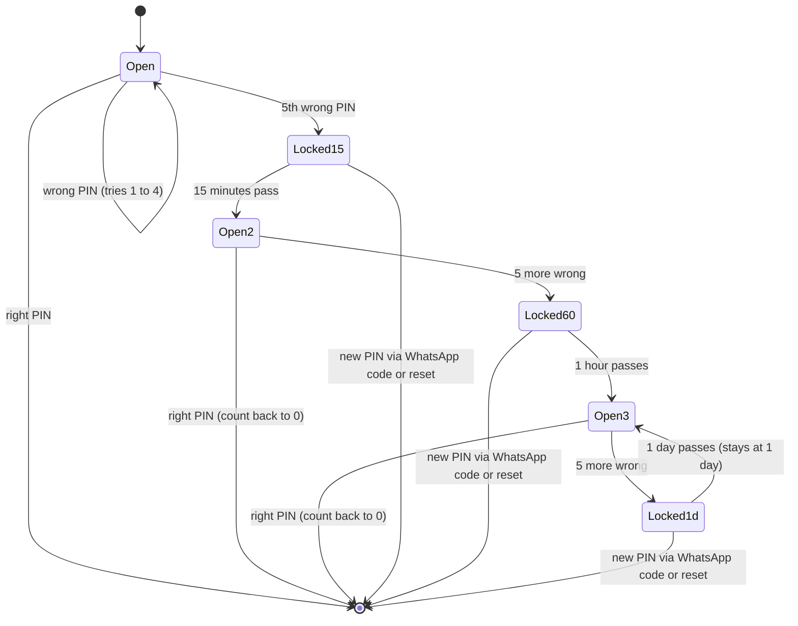

### 3.3 WhatsApp code

A 6-digit code sent on WhatsApp. Used for: a new phone, a first sign-in, a forgotten or reset
PIN, changing your number, and every customer sign-in.

| Limit | Value |
| --- | --- |
| Code is valid for | 10 minutes |
| Wrong tries per code | 5, then ask for a new code |
| Wait before asking again | 30 seconds |
| Codes per number per hour | 5 |
| Codes per internet connection per hour (customer sign-in) | 20 |

Asking for a new code cancels the old one. A code works once. Codes are stored only as a hash.

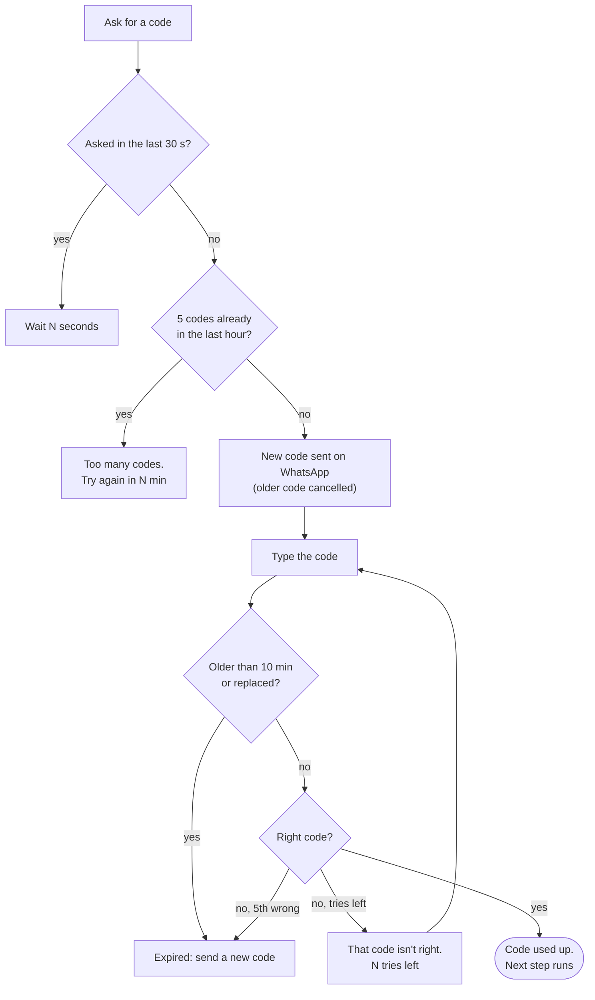

### 3.4 Trusted phone

Each install of the team app makes a long random key and keeps it in the phone's secure storage
(Keychain / Keystore). The server keeps only a hash of it next to the person's number.

- A phone becomes **trusted** for a number when that number's WhatsApp code is entered on it.
- A trusted phone goes **straight to the PIN pad**. An untrusted phone must enter a WhatsApp
  code first. The server refuses a PIN from an untrusted phone **before** checking it, so a
  stranger's phone can't even spend PIN guesses.
- The phone also remembers **"PIN used here"** once the right PIN is typed or chosen on it. Only
  such a phone lets an owner, manager or HQ reset their own PIN (5.5).
- Uninstalling the app throws the key away, so a reinstall is a new phone.

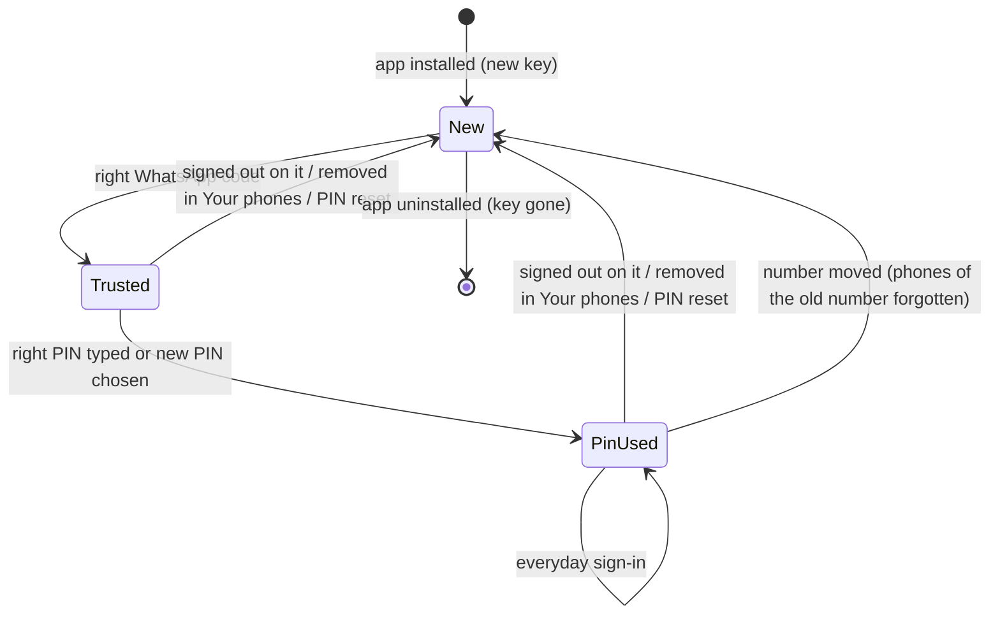

Technical: header `x-device-key` (32–128 chars), stored as SHA-256 in `trusted_devices (phone,
device_hash, label, pin_confirmed_at)`. The phone's model is sent as `x-device-name` for Your
phones. App side: `apps/manager/src/api/device.ts`.

### 3.5 Session

After sign-in the phone holds a session (a signed token) for **30 days**. The session works only
from the phone it was issued to. On every request the server re-reads the person, their phone
and their branch, so these take effect without waiting for the token to run out:

| Change | What the phone sees |
| --- | --- |
| Turned off by owner / manager / HQ | Signed out: "Your account has been turned off." |
| Removed from the team | Signed out |
| PIN changed, reset or self-reset; number changed | Signed out: "Your PIN or phone number was changed. Sign in again." (the phone that made the change stays in) |
| This phone signed out, removed in Your phones, or forgotten by a reset | Signed out |
| Branch closed by HQ | Signed out with HQ's reason |
| Branch paused by HQ | Stays in; a banner shows HQ's reason; new washes blocked |
| Role changed | Applies on the next request |
| Owner or manager on a short PIN | Must choose a 6-digit PIN before anything else |
| 30 days pass | Signed out: "Your session ended. Please sign in again." |

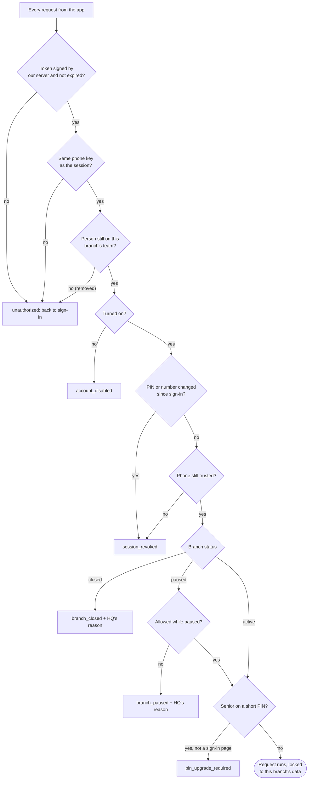

**Timing.** Every change (saving a wash, taking cash, editing anything) is checked fresh, so it
is blocked at once. Screens that only *show* data may reuse the check for up to 30 seconds on
the same server, so someone just turned off, or a branch just closed, can still *see* (never
change) for up to 30 seconds.

Technical: JWT claims `sub` (user row), `shopId`, `role`, `phone`, `sv` (session version) and
`dv` (hash of the phone key). Every sign-in requires the phone key (`device_key_required`
otherwise), so no session exists that isn't tied to a phone. Any PIN set or clear, reset,
removal, turning off or number change bumps `users.session_version` (`session_revoked`).

---

## 4. Signing in: how the app decides what to ask

The person types their number and the server answers with the next step.

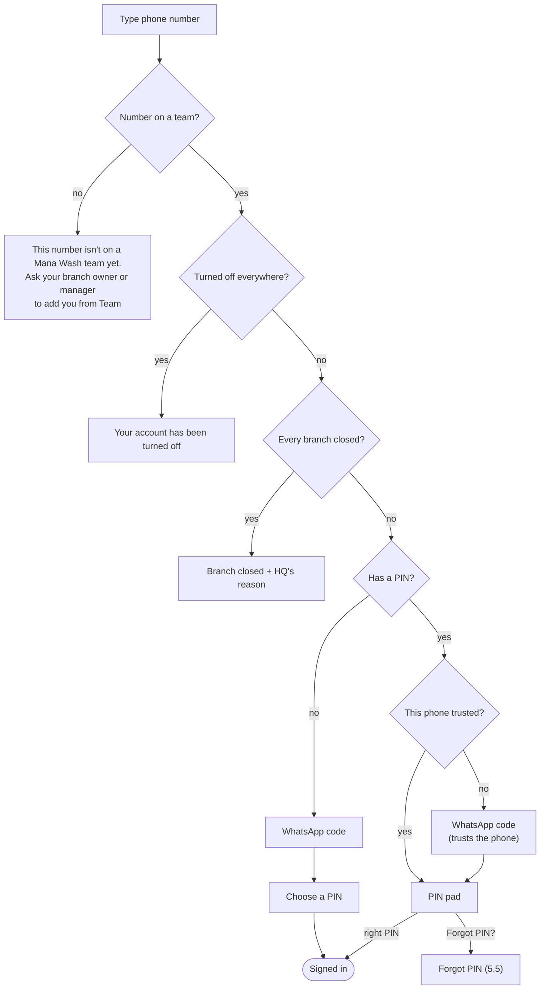

**Which branch opens:** the one this phone last used, if the person still works there and it
isn't closed; otherwise their first open branch. They can switch afterwards (7.5).

**Shared shop phone:** the app remembers the last number and opens straight on its PIN pad. It
quietly re-checks that number first; if it lost its PIN, the phone lost trust, or the number was
taken off every team, the app moves to the right step and says why.

Technical:

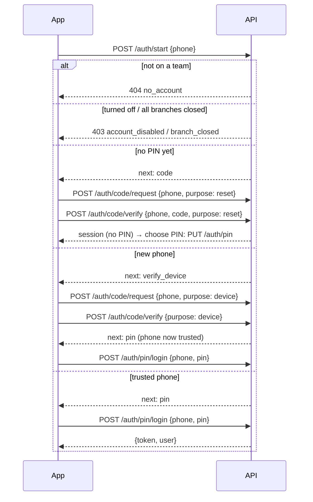

---

## 5. Sign-in scenarios

### 5.1 Everyday sign-in (trusted phone)

Number → PIN → in.

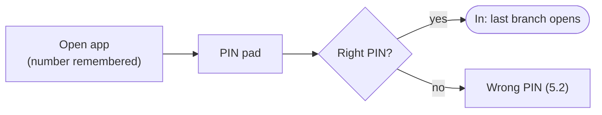

### 5.2 Wrong PIN

"That PIN isn't right. N tries left." After the 5th wrong try: "Too many wrong PINs. Try again
later." The lock lasts 15 minutes, then 1 hour, then 1 day for each lock in a row. They can wait,
or use **Forgot PIN?** (5.5) right away, which also clears the lock.

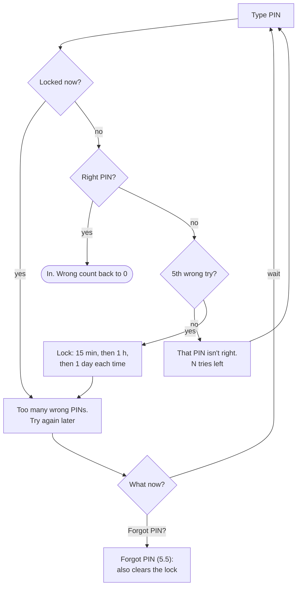

### 5.3 New phone, PIN remembered

Number → "Confirm with a code on WhatsApp" → code → PIN → in. The new phone is now trusted. Old
phones stay trusted until signed out or removed in Your phones (7.6).

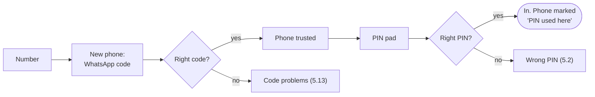

### 5.4 First ever sign-in (no PIN yet)

For a new owner HQ just named, someone added from Team, or someone whose PIN was reset.
Number → WhatsApp code → choose a PIN (6 digits for owners, managers and HQ; 4–6 for staff) → in.

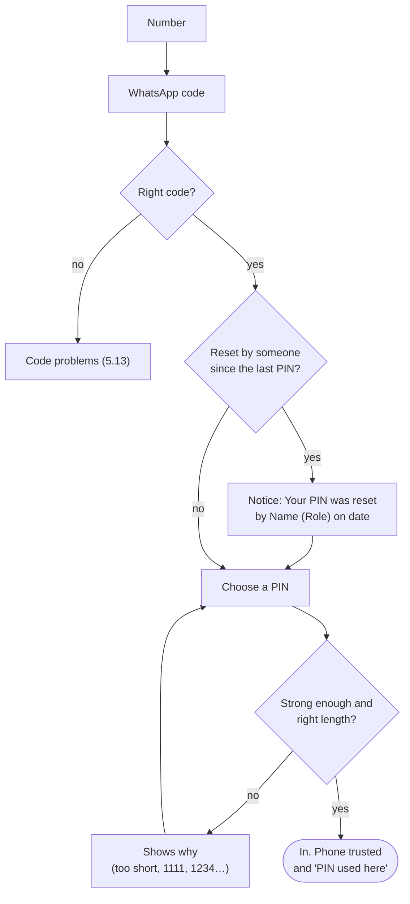

### 5.5 Forgot PIN

**Forgot PIN? → Send code on WhatsApp** → code → choose a new PIN → in.

- **Staff:** works on any phone.
- **Owners, managers and HQ:** only on a phone where they've used their PIN before. On any
  other phone the app says so before sending a code, and they ask the person above them to
  reset it (section 8). A stolen SIM or WhatsApp alone can't take over a branch.
- The old PIN is cleared on every branch, every other phone is signed out (they stay trusted,
  so the new PIN works there), and the lock is cleared.
- If they close the app before choosing the new PIN, they simply have no PIN: next time is 5.4.

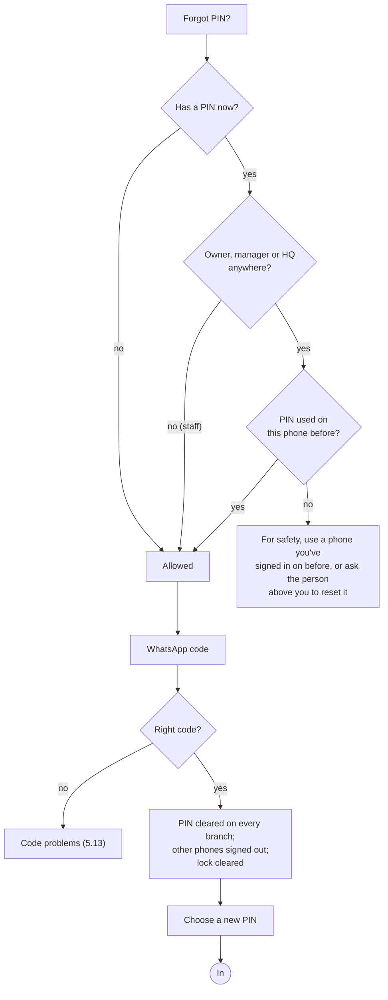

### 5.6 Lost phone, or no access to the old WhatsApp

They can't get a code, so the person above them resets their PIN (section 8). Then, on a new
phone with the same number (a new SIM): WhatsApp code → choose a PIN → in, with a notice "Your
PIN was reset by *Name (Role)* on *date*". If they have a **new number** too, the owner (or HQ,
for an owner) removes the old number and adds the new one from Team.

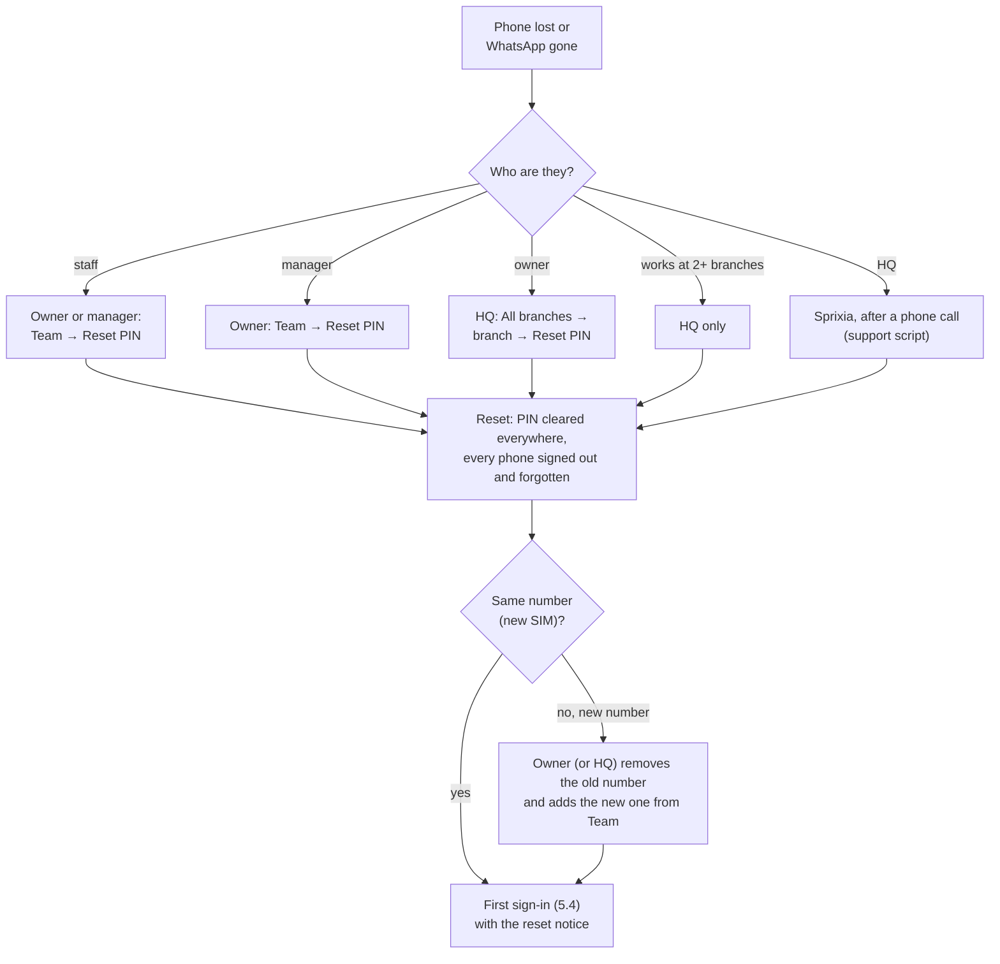

### 5.7 PIN locked and urgent

A WhatsApp code through **Forgot PIN?** clears both the PIN and the lock (same rules as 5.5).
Owners, managers and HQ on a phone where their PIN was never used ask the person above them.

### 5.8 Turned off

At sign-in: "Your account has been turned off." If they're turned off at one branch but active at
another, they sign in to the other one.

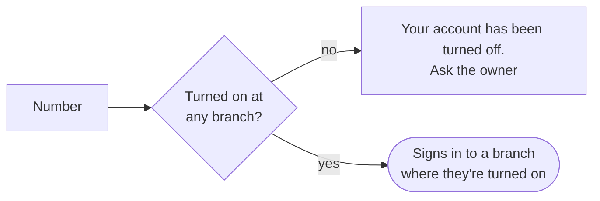

### 5.9 Branch closed

If every branch they work at is closed: the closed message with HQ's reason. If they work at
another open branch, they're signed in there and the closed one disappears from their list.

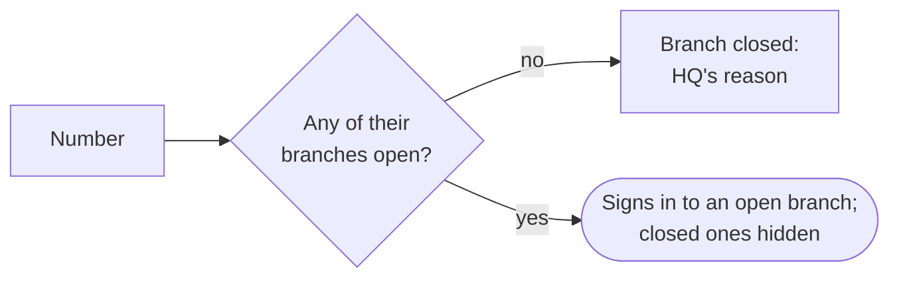

### 5.10 Branch paused

Sign-in works normally. Home shows "Paused by Mana Wash HQ: *reason*". See 9.4 for what still
works.

### 5.11 Owner or manager with a 4- or 5-digit PIN

They sign in with the old PIN, then the app shows **Choose a 6-digit PIN**: the current PIN, then
a new 6-digit one. Until then the server refuses everything except the sign-in pages. The same
happens when staff with a 4-digit PIN are promoted to manager or owner, and on HQ screens for an
HQ admin on a short PIN.

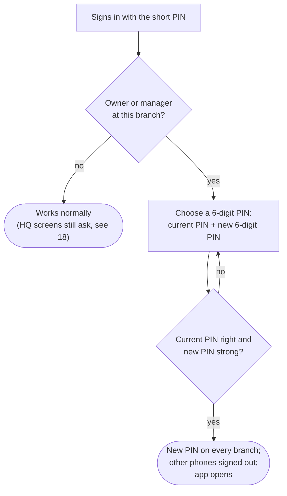

### 5.12 Number not on any team

"This number isn't on a Mana Wash team yet. Ask your branch owner or manager to add you from
Team." No WhatsApp code is sent. There is no way to sign yourself up (6.1).

### 5.13 WhatsApp code problems

| What they see | Why | What to do |
| --- | --- | --- |
| Wait N seconds | Asked again within 30 s | Wait |
| Too many codes asked for. Try again in N min. | 5 codes in the last hour | Wait, or call the owner |
| That code isn't right. N tries left. | Typo | Retype |
| This code has expired or was replaced. | Older than 10 min, 5 wrong tries, or a newer code was sent | Send a new code |
| WhatsApp codes aren't set up on the server yet. | Server setting | Sprixia support |
| Couldn't send the WhatsApp message. | WhatsApp failed to send | Try again in a minute |

The flow is the code chart in 3.3.

### 5.14 Someone tries to get into another person's account

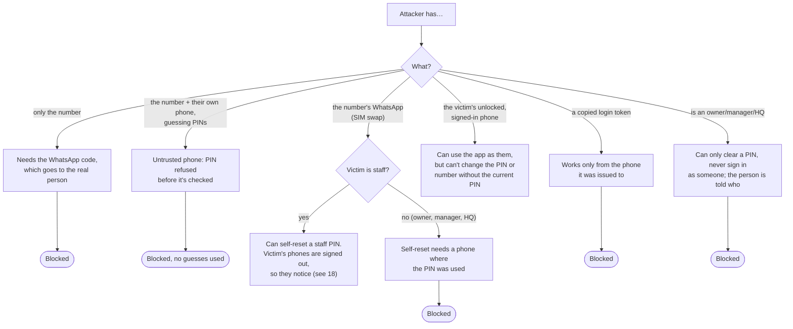

### 5.15 Too many attempts from one place

Requests are also capped per internet connection per 10 minutes (section 13). Beyond that the
app shows "Too many tries from this network. Wait N min and try again." Limits leave room for a
whole team on one shop Wi-Fi.

---

## 6. Getting onto a team

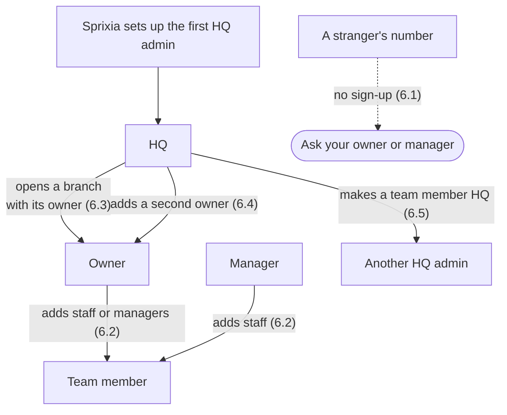

### 6.1 Nobody signs themselves up

There is no sign-up and no "join with a branch ID". People are hired face to face, so whoever
hires them adds them: the owner or a manager from Team (6.2), or HQ for owners (6.3, 6.4). A
number on no team is told to ask them and no WhatsApp code is sent to it.

### 6.2 Added from Team

The owner (staff or managers) or a manager (staff only) adds a name and number in **More → Team**.

- **New number:** they sign in with a WhatsApp code and choose a PIN (5.4).
- **Number already at another branch:** they **keep their PIN and name**; the new branch appears
  in their branch list. On a phone already trusted they go straight to the PIN.
- **Refused** if the number is already on this team, already works at 10 branches, or the branch
  is paused.

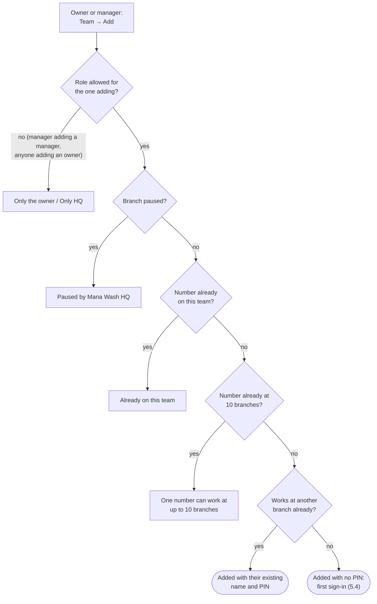

### 6.3 HQ opens a branch

HQ: **More → Mana Wash HQ → All branches → Open a branch** with the branch name, city, and the
owner's name and number. The branch gets the Mana Wash menu straight away and a 6-digit branch ID.

- **New owner number:** they sign in with a WhatsApp code and choose a 6-digit PIN.
- **Existing person** (owner elsewhere, or staff somewhere): they keep their PIN; if it's shorter
  than 6 digits they're asked for a 6-digit one (5.11).

```mermaid
flowchart TD
  A["HQ: Open a branch"] --> B{"Owner's number at<br/>10 branches already?"}
  B -- "yes" --> X["Refused"]
  B -- "no" --> C["Branch created in the<br/>Mana Wash business"]
  C --> D["Owner added<br/>(existing PIN kept, if any)"]
  D --> E["Menu built from<br/>HQ's services and prices"]
  E --> F(["Owner signs in:<br/>5.4 (new) or 5.11 (short PIN)"])
```

### 6.4 HQ adds, promotes or removes an owner

HQ adds a second owner, promotes a teammate to owner, or removes an owner. Owners and managers
can't ("Only Mana Wash HQ can add, change or remove branch owners"). The last active owner can't
be removed.

```mermaid
flowchart TD
  A["Change to an owner"] --> B{"Done by HQ?"}
  B -- "no" --> X1["Only Mana Wash HQ can add,<br/>change or remove branch owners"]
  B -- "yes" --> C{"Removing, demoting or<br/>turning off the last active owner?"}
  C -- "yes" --> X2["The shop needs at least<br/>one active owner"]
  C -- "no" --> D(["Done. A removed or demoted owner<br/>is affected on their next request"])
```

### 6.5 Becoming HQ

An existing HQ admin adds a number in **Mana Wash HQ → admins**. The number must already be on a
team at one of the business's branches; anything else is refused (`not_on_team`). So a mistyped
number, or one the telco later gives to someone new, can never become HQ. The first HQ admin is
set up by Sprixia. HQ sees the **Mana Wash HQ** section in More on any branch they're signed in to.
The last HQ admin can't be removed.

```mermaid
flowchart TD
  A["HQ: add an admin"] --> B{"Number on a team at a<br/>Mana Wash branch?"}
  B -- "no" --> X["Add this person to a branch team first,<br/>then make them HQ"]
  B -- "yes" --> C(["Now HQ. Owners, managers and HQ<br/>need a 6-digit PIN"])
  D["HQ: remove an admin"] --> E{"Last HQ admin?"}
  E -- "yes" --> Y["Add another admin before<br/>removing the last one"]
  E -- "no" --> F(["No longer HQ"])
```

---

## 7. While signed in

### 7.1 Change PIN (More → Change PIN)

The current PIN, then the new one (6 digits for seniors). Changes it on every branch. Every other
phone is signed out (and stays trusted).

```mermaid
flowchart TD
  A["Change PIN"] --> B["Current PIN"] --> C{"Locked?"}
  C -- "yes" --> X1["Too many wrong PINs"]
  C -- "no" --> D{"Right?"}
  D -- "no" --> X2["Wrong PIN, N tries left<br/>(counts toward the lock)"]
  D -- "yes" --> E["New PIN"] --> F{"Strong and<br/>right length?"}
  F -- "no" --> F1["Shows why"] --> E
  F -- "yes" --> G(["Changed everywhere. This phone stays in;<br/>others signed out"])
```

### 7.2 Move to a 6-digit PIN

Same as 7.1, started automatically (5.11).

### 7.3 Change name

More → Edit profile. Changes it on every branch.

### 7.4 Change phone number (More → Edit profile → number)

1. Type the new number. A WhatsApp code goes to the **new** number, so a typo can't lock them out.
2. Enter that code **and the current PIN**, so a borrowed, unlocked phone can't move the account.
3. The number changes on every branch, and HQ status moves with it. This phone stays signed in
   and is trusted for the new number. Every other phone is signed out, and phones trusted for the
   old number are forgotten.

```mermaid
flowchart TD
  A["New number"] --> B{"Same as now?"}
  B -- "yes" --> X1["That's already your number"]
  B -- "no" --> C{"Has a PIN?"}
  C -- "no" --> X2["Set a PIN first"]
  C -- "yes" --> D{"Number used by<br/>someone else?"}
  D -- "yes" --> X3["Already registered<br/>to another account"]
  D -- "no" --> E["WhatsApp code to the NEW number"]
  E --> F["Code + current PIN"] --> G{"PIN right<br/>and not locked?"}
  G -- "no" --> X4["Wrong PIN / locked"]
  G -- "yes" --> H{"Code right?"}
  H -- "no" --> X5["Code problems (5.13)"]
  H -- "yes" --> I(["Number moved on every branch, HQ moves too;<br/>this phone trusted for the new number;<br/>old phones forgotten; others signed out"])
```

### 7.5 Switch branch

Tap the branch name at the top → pick another branch. No PIN again (same person, already proved).
Closed branches aren't listed; paused ones are marked "Paused".

```mermaid
flowchart TD
  A["Pick another branch"] --> B{"One of their branches?"}
  B -- "no" --> X1["You aren't part of that shop"]
  B -- "yes" --> C{"Turned on there?"}
  C -- "no" --> X2["Your access to that shop is turned off"]
  C -- "yes" --> D{"Closed?"}
  D -- "yes" --> X3["Branch closed: HQ's reason"]
  D -- "no" --> E(["New session for that branch,<br/>same phone, no PIN"])
```

### 7.6 Your phones (More → Your phones)

Lists every phone the number is trusted on, with its model and when it was last used.

- **Sign out one phone:** that phone is signed out at once and forgotten; it needs a WhatsApp code
  to come back. The phone you're holding can't be removed here (use Sign out, 7.7).
- **Sign out all other phones:** every other phone is signed out and forgotten; this one stays in.

```mermaid
flowchart TD
  A["Your phones"] --> B{"Action"}
  B -- "remove one phone" --> C{"Is it this phone?"}
  C -- "yes" --> X["To sign out this phone,<br/>use Sign out"]
  C -- "no" --> D(["That phone signed out and forgotten:<br/>WhatsApp code to come back"])
  B -- "sign out all others" --> E(["Every other phone signed out<br/>and forgotten; this one stays in"])
```

### 7.7 Sign out (More → Sign out)

Ends the session on this phone and **stops trusting this phone** for the number. Next time on
this phone: WhatsApp code, then PIN. Works even if the session was already ended remotely.

```mermaid
flowchart LR
  A["Sign out"] --> B["This phone forgotten<br/>for the number"] --> C["Session ends"] --> D(["Next time here:<br/>WhatsApp code, then PIN"])
```

### 7.8 Signed out by someone else

See the table in 3.5. The app returns to the sign-in screen and shows why.

---

## 8. PIN resets: the ladder

| Whose PIN | Who can reset it | Where |
| --- | --- | --- |
| Staff | Owner, manager, HQ | More → Team → the person → Reset PIN |
| Manager | Owner, HQ | More → Team → the person → Reset PIN |
| Owner | HQ | More → Mana Wash HQ → All branches → the branch → Reset PIN |
| Anyone at 2+ branches | HQ only (their one PIN covers branches the resetter doesn't run) | All branches → the branch → team → Reset PIN |
| HQ | Sprixia, after a phone call | Support script (section 15) |
| Yourself | Nobody resets themselves: use Forgot PIN? (5.5) or Change PIN (7.1) | — |

```mermaid
flowchart TD
  A["Reset PIN tapped"] --> B{"Resetting yourself?"}
  B -- "yes" --> X1["Change your own PIN from<br/>More → Change PIN"]
  B -- "no" --> C{"Target's role vs yours"}
  C -- "target is owner,<br/>you're not HQ" --> X2["Only Mana Wash HQ"]
  C -- "target is manager,<br/>you're a manager" --> X3["Only the owner"]
  C -- "allowed" --> D{"Target works at<br/>another branch too?"}
  D -- "yes, you're not HQ" --> X4["Only Mana Wash HQ can reset their PIN"]
  D -- "no, or you're HQ" --> E["Confirm"] --> F
  F["1. PIN cleared on every branch<br/>2. Signed out on every phone<br/>3. Every trusted phone forgotten<br/>4. Logged: Name (Role)"]
  F --> G(["Nobody signed in. The person uses a WhatsApp code,<br/>chooses a new PIN and sees who reset it"])
```

---

## 9. Taking access away

### 9.1 Turn off (Team → the person → access off)

Signed out at once. Can't sign in to that branch. Their work and name stay in the records.
Turning back on lets them sign in again with their existing PIN.

### 9.2 Remove from team

Off the team for good at this branch, and signed out. Their number can be added at another
branch later. Their other branches aren't affected.

### 9.3 Change role

Owner: staff ↔ manager. HQ: anything, including owner. Applies on the next request. Promoted to
manager or owner on a short PIN → asked for a 6-digit PIN (5.11).

```mermaid
flowchart TD
  A["Team → the person"] --> B{"Action"}
  B -- "turn off" --> C["Signed out now;<br/>can't sign in here"] --> C2["Turn back on → signs in<br/>with the same PIN"]
  B -- "remove" --> D["Off this team for good;<br/>signed out; number free here"]
  B -- "change role" --> E["Applies on next request;<br/>senior on short PIN → 5.11"]
  C & D & E --> F{"Would leave the branch<br/>with no active owner?"}
  F -- "yes" --> X["Refused: the shop needs<br/>at least one active owner"]
  B -- "it's yourself" --> Y["Refused: you can't change<br/>your own role or access"]
```

### 9.4 Pause a branch (HQ, reason of 3–200 characters)

- Everyone stays signed in and sees HQ's reason on Home.
- **Still works:** viewing everything; finishing washes already open (status, washers, sellers,
  payment, payment method, void); photos; the cash counter's float, close and reopen; sign-in and
  account pages; HQ's own work.
- **Blocked:** new washes and every other change, including adding teammates.

### 9.5 Close a branch (HQ, with a reason)

- Everyone there is signed out with HQ's reason and can't sign in to it.
- People who also work at another branch are signed in there instead.
- Hidden from customers.
- HQ can't close the branch it's signed in to (switch first).

### 9.6 Reopen

HQ sets the branch back to Active. Everyone can sign in again with their existing PIN. Every
status change is logged with who made it and why (All branches → the branch → history).

```mermaid
stateDiagram-v2
  [*] --> Active: HQ opens the branch
  Active --> Paused: HQ pauses (reason)
  Paused --> Active: HQ reopens
  Active --> Closed: HQ closes (reason)
  Paused --> Closed: HQ closes (reason)
  Closed --> Active: HQ reopens
  note right of Paused
    Signed in, banner with reason.
    Finish open washes only.
  end note
  note right of Closed
    Nobody signs in here.
    Hidden from customers.
  end note
```

---

## 10. Journeys by person

### 10.1 Staff

```mermaid
flowchart TD
  A["Owner or manager adds<br/>my name and number"] --> B["First sign-in:<br/>WhatsApp code → choose 4–6 digit PIN"]
  B --> C["Every day: PIN on my phone"]
  C --> D{"Something happens"}
  D -- "forgot PIN" --> E["Forgot PIN? → WhatsApp code<br/>→ new PIN (any phone)"]
  D -- "new phone" --> F["WhatsApp code → PIN"]
  D -- "lost phone / WhatsApp" --> G["Ask owner or manager<br/>to reset → first sign-in"]
  D -- "new number" --> H["Change number myself (7.4),<br/>or owner re-adds me"]
  D -- "promoted to manager" --> I["Choose a 6-digit PIN (5.11)"]
  D -- "turned off / removed" --> J(["Signed out"])
  D -- "work at 2 branches" --> K["Same PIN; switch branch<br/>from the top"]
```

### 10.2 Manager

```mermaid
flowchart TD
  A["Owner (or HQ) adds or<br/>promotes me"] --> B["6-digit PIN"]
  B --> C["Every day: PIN"]
  C --> D{"Team work"}
  D -- "hire a washer" --> E["Team → Add (staff only)"]
  D -- "washer forgot PIN<br/>and lost WhatsApp" --> F["Team → Reset PIN (staff)"]
  D -- "washer leaves" --> G["Team → Remove (staff)"]
  C --> H{"My own trouble"}
  H -- "forgot PIN" --> I["Forgot PIN? only on a phone<br/>where I used my PIN"]
  H -- "lost phone" --> J["Owner resets my PIN"]
```

### 10.3 Owner (own or franchise branch)

```mermaid
flowchart TD
  A["HQ opens my branch<br/>with my number"] --> B["First sign-in: WhatsApp code<br/>→ choose 6-digit PIN"]
  B --> C["Every day: PIN"]
  C --> D{"Running the team"}
  D -- "add staff or managers" --> E["Team → Add"]
  D -- "reset staff or manager PIN" --> F["Team → Reset PIN"]
  D -- "turn off / remove" --> G["Team (never the last owner,<br/>never myself)"]
  D -- "branch name, city" --> H["More → shop name"]
  C --> I{"My own trouble"}
  I -- "forgot PIN" --> J["Forgot PIN? on a phone<br/>where I used my PIN"]
  I -- "lost phone" --> K["HQ resets my PIN"]
  I -- "new owner partner" --> L["HQ adds them"]
```

### 10.4 Mana Wash HQ

```mermaid
flowchart TD
  A["Sprixia sets up the first HQ;<br/>HQ adds others (team members only)"] --> B["Signs in at a branch<br/>(usually as its owner)"]
  B --> C["More → Mana Wash HQ"]
  C --> D{"HQ work"}
  D -- "new branch" --> E["Open a branch + owner"]
  D -- "owners" --> F["Add, promote, remove,<br/>reset owner PINs"]
  D -- "anyone at 2+ branches" --> G["Reset their PIN"]
  D -- "branch problem" --> H["Pause / close / reopen<br/>with a reason"]
  D -- "menu" --> I["Services, prices, plans<br/>for every branch"]
  D -- "admins" --> J["Add / remove HQ admins<br/>(never the last)"]
  B --> K{"My own trouble"}
  K -- "forgot PIN" --> L["Forgot PIN? on a phone<br/>where I used my PIN"]
  K -- "lost phone and WhatsApp" --> M["Call Sprixia → support reset"]
```

### 10.5 Sprixia (support)

```mermaid
flowchart TD
  A["HQ calls: lost phone,<br/>no WhatsApp, PIN forgotten"] --> B["Call back on the number on file<br/>and confirm it's really them"]
  B --> C{"Confirmed?"}
  C -- "no" --> X(["No reset"])
  C -- "yes" --> D["npm run support:reset-pin<br/>--phone … --into remote --yes"]
  D --> E(["PIN cleared everywhere, phones forgotten,<br/>logged as 'Sprixia support'.<br/>HQ signs in with a WhatsApp code"])
```

### 10.6 Customer

```mermaid
flowchart TD
  A["Mana Wash app: number"] --> B["WhatsApp code"] --> C{"Customer at any<br/>listed branch?"}
  C -- "yes" --> D(["Signed in for 90 days:<br/>cars, washes, photos, rewards"])
  C -- "no" --> E(["Request pass (30 days):<br/>ask for a wash, follow the request"])
  D --> F{"Later"}
  F -- "sign out everywhere" --> G(["Every customer session ends"])
  F -- "delete account" --> H(["App account deleted;<br/>branches keep their wash records"])
```

---

## 11. Who can do what

| Action | Staff | Manager | Owner | HQ |
| --- | :-: | :-: | :-: | :-: |
| Change own PIN / name / number | ✓ | ✓ | ✓ | ✓ |
| See and manage own phones | ✓ | ✓ | ✓ | ✓ |
| Add, edit, turn off, remove **staff** | | ✓ | ✓ | ✓ |
| Reset a **staff** PIN | | ✓ | ✓ | ✓ |
| Add, edit, turn off, remove **managers**; reset their PIN | | | ✓ | ✓ |
| Add, edit, remove **owners**; reset their PIN | | | | ✓ |
| Reset anyone who works at 2+ branches | | | | ✓ |
| Open, pause, close, reopen branches | | | | ✓ |
| Add or remove HQ admins | | | | ✓ |
| See all branches' numbers | | | | ✓ |

The HQ column applies on top of HQ's role at the branch they're signed in to. Team actions on a
branch need the owner or manager role there; HQ's All branches screen covers every branch.

```mermaid
flowchart TD
  A["Can I manage this teammate?"] --> B{"Their role"}
  B -- "owner" --> C{"Am I HQ?"}
  C -- "yes" --> Y(["Yes"])
  C -- "no" --> N(["No"])
  B -- "manager" --> D{"Am I HQ or an owner?"}
  D -- "yes" --> Y
  D -- "no" --> N
  B -- "staff" --> E{"Am I HQ, an owner<br/>or a manager?"}
  E -- "yes" --> Y
  E -- "no" --> N
```

---

## 12. The customer app (Mana Wash)

- **Sign-in:** phone number → WhatsApp code → in. No PIN, no trusted phones.
- **Only existing customers sign in.** If the number is a customer at one or more listed
  branches, they see their cars, washes, photos, rewards and receipts from those branches only.
- **Unknown number:** they see nothing private, but get a request pass (valid 30 days) to ask
  for a wash and follow that request.
- **Session:** 90 days, re-checked on every request.
- **Sign out everywhere** ends every customer session for the number.
- **Delete account** removes their app account and signs them out everywhere.
- Code limits as in 3.3; 30 sign-in requests per connection per 10 minutes.

```mermaid
flowchart TD
  A["Number"] --> B["WhatsApp code<br/>(20 per connection per hour)"] --> C{"Right code?"}
  C -- "no" --> X["Code problems (5.13)"]
  C -- "yes" --> D{"Customer at a listed branch?"}
  D -- "yes" --> E(["Customer session (90 days)"])
  D -- "no" --> F["Request pass (30 days)"] --> G["Request service<br/>(location or area)"]
  G --> H{"Area served?"}
  H -- "yes" --> I(["Pending: nearest branch calls them"])
  H -- "no" --> J(["Out of area: kept for later"])
  I --> K["Branch approves → now a customer"] --> L(["Next sign-in opens the account"])
```

Technical: `POST /c/auth/code`, `POST /c/auth/verify` → `{ status: 'signed_in', token }` or
`{ status: 'request', ticket }`. `requireCustomer` re-reads the account (session version) each
time. Customer tokens and team tokens use different keys and can't be swapped.

---

## 13. All limits in one place

| Limit | Value |
| --- | --- |
| Session (team app) | 30 days, tied to one phone |
| Session (customer app) | 90 days |
| PIN length | seniors 6; staff 4–6 |
| Wrong PINs before a lock | 5 |
| Lock time | 15 minutes, then 1 hour, then 1 day each time |
| WhatsApp code | 6 digits, 10 min, 5 tries, works once |
| Code resend wait | 30 seconds |
| Codes per number per hour | 5 |
| Codes per connection per hour (customer sign-in) | 20 |
| Branches per number | 10 |
| Pause/close reason | 3–200 characters |
| Requests per connection per 10 min | number check 60; PIN sign-in 40; WhatsApp codes 20; change number 10; number-change code 10; customer sign-in 30 |
| "View only" delay after removal or closure | up to 30 seconds |
| Customer request pass | 30 days |

---

## 14. Error codes

What the server returns and what the team app does with it.

| Code | HTTP | Meaning | App behaviour |
| --- | --- | --- | --- |
| `unauthorized` | 401 | No or bad token, removed, wrong phone, or wrong branch | Back to sign-in |
| `session_revoked` | 401 | PIN or number changed or reset, or this phone forgotten | Back to sign-in with notice |
| `account_disabled` | 403 | Turned off | Back to sign-in with notice |
| `branch_closed` | 403 | HQ closed the branch | Back to sign-in with HQ's reason |
| `branch_paused` | 403 | Change not allowed while paused | Banner / toast with HQ's reason |
| `pin_upgrade_required` | 403 | Senior with a short PIN | Choose a 6-digit PIN |
| `no_account` | 404 | Number on no team | "Ask your branch owner or manager to add you from Team" |
| `device_not_trusted` | 403 | PIN from an untrusted phone | Moves to the WhatsApp code step |
| `device_key_required` | 400 | Sign-in without a phone key (the app always sends one) | "Close the app, open it again and try once more" |
| `reset_needs_known_phone` | 403 | Senior self-reset on a phone where their PIN was never used | Explains, and who can reset it |
| `pin_not_set` | 409 | No PIN yet | Moves to the WhatsApp code step |
| `invalid_pin` | 401 | Wrong PIN | Shows tries left |
| `pin_locked` | 423 | Too many wrong PINs | Shows the lock; offers Forgot PIN |
| `current_pin_required` | 400 | Changing PIN without the current one | Asks for it |
| `weak_pin` | 400 | Too short or long, repeated or a sequence | Shows why |
| `invalid_code` | 401 | Wrong WhatsApp code | Shows tries left |
| `code_expired` | 410 | Code too old, used up or replaced | Send a new code |
| `too_soon` | 429 | Code asked again within 30 s | Countdown |
| `too_many` | 429 | Hourly code cap | Shows the wait |
| `rate_limited` | 429 | Too many requests from one connection | "Too many tries from this network. Wait N min" |
| `code_not_configured` | 503 | WhatsApp not set up on the server | Call support |
| `send_failed` | 502 | WhatsApp send failed | Try again |
| `same_phone` / `phone_taken` | 400 / 409 | Number change problems | Shows why |
| `forbidden` / `hq_only` | 403 | Team action above your role | Shows who can |
| `works_elsewhere` | 403 | Reset of a multi-branch person by a non-HQ | "Only Mana Wash HQ can reset their PIN" |
| `cannot_change_self` | 400 | Own role, access, removal or reset | Shows where to do it instead |
| `last_owner` | 400 | Would leave the branch with no owner | Shows why |
| `too_many_shops` | 409 | Number already at 10 branches | Shows why |
| `this_phone` | 400 | Removing the phone you're holding in Your phones | "Use Sign out" |
| `not_on_team` | 409 | Making a number HQ that isn't on any branch team | "Add them to a branch team first" |
| `last_admin` | 409 | Removing the last HQ admin | "Add another admin first" |
| `cannot_close_own` | 400 | HQ closing the branch they're in | Switch first |

---

## 15. Support runbooks

```mermaid
flowchart TD
  A["Someone can't get in"] --> B{"What do they say?"}
  B -- "forgot my PIN" --> C{"Staff?"}
  C -- "yes" --> C1["Forgot PIN? → WhatsApp code"]
  C -- "no" --> C2{"On a phone where they<br/>used their PIN?"}
  C2 -- "yes" --> C1
  C2 -- "no" --> R["Person above resets (section 8)"]
  B -- "lost my phone" --> R
  B -- "no WhatsApp code arrives" --> W["Check the number is on WhatsApp;<br/>wait 30 s and resend; after 5 in an hour,<br/>wait. Server: WhatsApp settings"]
  B -- "branch is closed" --> H["HQ reopens it in All branches"]
  B -- "account turned off" --> O["Owner turns them back on in Team"]
  B -- "number not on a team" --> T["Owner or manager adds them in Team"]
  R --> S{"Are they HQ?"}
  S -- "yes" --> SP["Sprixia: support script<br/>after a call-back"]
  S -- "no" --> AB["Owner / manager / HQ: Reset PIN"]
```

**Staff or manager forgot their PIN:** Forgot PIN? → WhatsApp code. A manager must be on a phone
where they've used their PIN. Otherwise, or with no WhatsApp: the owner taps Reset PIN in Team.

**Owner lost their phone:** HQ: All branches → the branch → Reset PIN. The owner signs in on the
new phone with a WhatsApp code (same number, new SIM).

**HQ lost their phone and has no WhatsApp:** Sprixia, after confirming the person on a call back:

```bash
cd apps/api
npm run support:reset-pin -- --phone 98XXXXXXXX --into remote --yes --by "Name (Sprixia)"
```

`--into local` or `--into staging` to rehearse first. `--by` is what the person is shown.

**Someone left:** the owner (or a manager, for staff) removes them from Team. For an owner, HQ
does it. Removal signs them out.

**Phone stolen:** reset the person's PIN (forgets every phone), or they use **Your phones → sign
out** that phone from another phone of theirs.

**Branch must stop new washes today:** HQ pauses it with a reason.

---

## 16. Security design

- **Something you have + something you know.** Daily sign-in needs a trusted phone *and* the PIN.
  A new phone needs the number's WhatsApp *and* the PIN.
- **The PIN is never checked from an untrusted phone**, so a stranger can't guess PINs at all.
- **Guessing is bounded** per person (5 PIN tries then growing locks; 5 tries per code; 5 codes an
  hour) and per connection (section 13). A guess is reserved before it's checked, so parallel
  guesses can't go over the limit.
- **A SIM swap can't take over a branch.** Owners, managers and HQ self-reset only on a phone
  where their PIN was used.
- **Every session is tied to one phone.** A copied token is useless elsewhere and dies when that
  phone is signed out, removed or forgotten.
- **Nobody signs in as someone else.** Resets only clear a PIN; the person must prove the number
  and is told who reset them; every reset is logged.
- **Sensitive changes need the current PIN** (change PIN, change number).
- **HQ only from the team.** A number must already be on a branch team to be made HQ; HQ moves
  with a number change, so a recycled old number never keeps HQ.
- **Every request re-checks** the person, their access, PIN version, phone and branch status.
- **Stored secrets are hashed:** PINs (PBKDF2), codes and phone keys (SHA-256). Tokens are signed
  with the server's secret.
- **Branches are isolated:** a session is locked to one branch's data. Another branch needs a
  switch, which only works for the same person. One franchise never sees another's data.
- **Customer and team sign-ins are separate** systems with separate token keys.

---

## 17. Development and testing

- **Local dev** accepts the code **`000000`** for any number instead of sending WhatsApp (dev mode
  / `WHATSAPP_OTP_BYPASS`).
- **Staging** accepts it **only for the numbers in `STAGING_TEST_PHONES`** (`apps/api/wrangler.toml`:
  the demo team), so nobody can sign in to staging as someone else. Add a tester's number to let
  them in. To run the test scripts against staging, set it to `*` for that run and take it out
  straight after.
- **Production** never accepts it.

```mermaid
flowchart TD
  A["Code asked for"] --> B{"Where?"}
  B -- "local dev (DEV_MODE + localhost)" --> L["000000, any number"]
  B -- "staging" --> S{"Number in<br/>STAGING_TEST_PHONES?"}
  S -- "yes (or *)" --> L2["000000"]
  S -- "no" --> W
  B -- "production" --> W["Real WhatsApp code"]
```

- Plain local database (`npm run db:reset:local`): owner and HQ `9100000000`, no PIN yet.
- Demo data (`npm run db:seed:demo`, on top of a reset): owner and HQ Hrushikesh `9888626111`,
  PIN `258025` for everyone.
- Checks, from `apps/api`, against a running local API on a freshly reset database:
  - `npm run test:access`: roles, resets, trusted phones, the 6-digit upgrade, pause and close,
    HQ overview, phone keys.
  - `npm run test:team`: no self sign-up, HQ opening branches and owners, adding and removing
    teammates, one person at two branches.
  - `npm run test:races`: parallel PIN and code guesses, last-owner rules, double adds, number
    change.
  - `npm run test:isolation`: branches can't see each other.
  - `npm run test:catalog`: HQ-only rules, including who can be made HQ.
  - `npm run test:customer-app`: customer sign-in.
- Unit tests for PIN rules and roles: `packages/domain`.

---

## 18. Known limits

- **WhatsApp is the only way onto a new phone.** No SMS fallback yet.
- **Whoever controls a staff number's WhatsApp can self-reset that PIN** (5.5). The staff member's
  phones are signed out, so they notice. Owners, managers and HQ are protected (5.5).
- **A new owner, manager or HQ with no PIN yet** can be signed in by whoever has the number's
  WhatsApp, until they choose a PIN. Ask new seniors to sign in straight away.
- **Up to 30 seconds of "view only"** after someone is removed or turned off, a phone is removed,
  or a branch is closed (3.5). Changes are blocked at once.
- **HQ whose role at their branch is staff** can use the branch screens on a short PIN; HQ screens
  ask for a 6-digit PIN first.
- **The HQ web dashboard and Sprixia admin panel** don't exist yet: HQ works from the app, Sprixia
  from the support script.

---

## 19. Glossary

| Word | Meaning |
| --- | --- |
| **Senior** | An owner, manager or HQ admin: 6-digit PIN, stricter self-reset |
| **Trusted phone** | A phone where the number's WhatsApp code was entered; goes straight to the PIN |
| **PIN used here** | A trusted phone where the right PIN was typed or chosen; allows a senior's self-reset |
| **Reset** | Someone above clears a PIN, signs out and forgets every phone; never signs anyone in |
| **Self-reset** | Forgot PIN? with a WhatsApp code |
| **Session** | The 30-day sign-in on one phone for one branch |
| **Branch ID** | A branch's 6-digit number, shown in its details so HQ and support can name it |
| **Request pass** | A customer-app pass for a number that isn't a customer yet: ask for service only |

---

## 20. Where it lives in the code

| Area | File |
| --- | --- |
| Sign-in, PIN, codes, sign out, change PIN, name or number, switch branch, Your phones | `apps/api/src/routes/auth.ts` |
| Team: add, edit, remove, reset | `apps/api/src/routes/team.ts` |
| HQ: branches, owners, status, overview, admins, resets | `apps/api/src/routes/business.ts`, `apps/api/src/lib/catalog.ts` |
| Session checks, pause rules, 30 s view cache | `apps/api/src/middleware/auth.ts` |
| Session token | `apps/api/src/lib/jwt.ts`, `apps/api/src/lib/session.ts` |
| Reset (clear PIN, sign out, forget phones, log) | `apps/api/src/lib/pinReset.ts` |
| Phone key | `apps/api/src/lib/device.ts`, `apps/manager/src/api/device.ts` |
| PIN hashing | `apps/api/src/lib/pin.ts` |
| WhatsApp codes and test codes | `apps/api/src/lib/phoneCode.ts`, `apps/api/src/lib/loginCode.ts`, `apps/api/src/lib/recovery.ts` |
| Rules and limits (roles, PIN rules, constants) | `packages/domain/src/team.ts` |
| Trusted phones and reset log | `packages/db/src/repositories/securityRepo.ts` |
| HQ admins | `packages/db/src/repositories/catalogRepo.ts` |
| Rate limits | `apps/api/src/index.ts`, `apps/api/src/lib/rateLimit.ts` |
| Customer sign-in | `apps/api/src/routes/customerApp.ts`, `apps/api/src/middleware/customer.ts` |
| HQ support reset | `apps/api/scripts/reset-pin.mjs` |
| App: sign-in screens | `apps/manager/src/screens/LoginScreen.tsx`, `CreatePinScreen.tsx` |
| App: Your phones | `apps/manager/src/components/PhonesSheet.tsx` |
| App: session, sign out, notices | `apps/manager/src/api/auth.tsx`, `client.ts`, `network.ts` |
